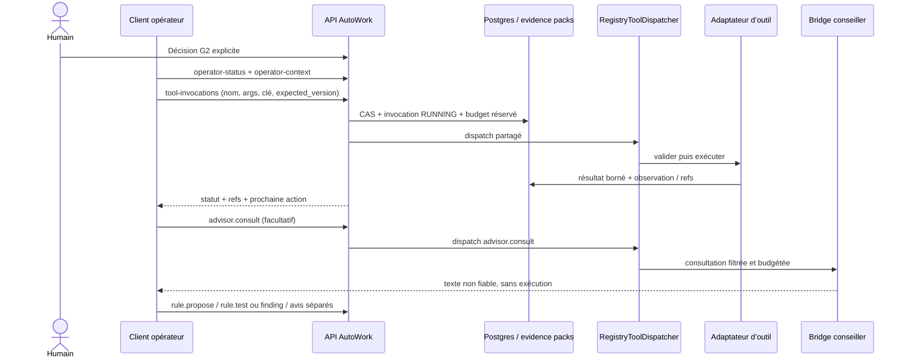

# Conception — investigation pilotée par un opérateur local

**Lot K0 — conception uniquement · 18 octobre 2026**

Ce document décrit une évolution de l’investigation où un client opérateur
authentifié choisit et lance chaque action via l’API AutoWork. Le Bridge reste
disponible comme conseiller textuel borné. Aucun code ni schéma n’est modifié
par ce lot.

## 1. État actuel et invariants

### Boucle actuelle

1. `InvestigationService.start()` crée ou reprend l’investigation issue d’une
   synthèse vérifiée, son état versionné, et l’enveloppe G2 approuvée lorsqu’elle
   existe (`backend/src/cti_app/application/investigation_service.py` —
   `InvestigationService.start`). L’API déclenche ensuite un job d’investigation.
2. `InvestigationService.run()` construit le contexte borné et canonique,
   réserve le budget Bridge, appelle `BridgeInvestigator.turn()`, valide la
   décision reçue puis transmet les outils, findings et changements proposés à
   `_process_turn()` (`backend/src/cti_app/application/investigation_service.py`
   — `InvestigationService.run`, `_process_turn`). Le Bridge choisit donc
   aujourd’hui la séquence, les arguments, les pivots et les propositions
   éditoriales. La validation du backend borne et refuse des demandes; elle ne
   remplace pas ce pilote.
3. `BridgeInvestigator.turn()` et
   `ModelConversationTurnTransport.submit()` enregistrent et réconcilient les
   tours du modèle, avec des clés déterministes liées à l’investigation, au
   tour et au hash du contexte (`backend/src/cti_app/application/bridge_investigator.py`
   — `BridgeInvestigator.turn`, `ModelConversationTurnTransport.submit`). Les
   sorties invalides, vides, ambiguës ou interrompues peuvent arrêter la boucle
   et exiger examen/reprise.
4. `ResearchContextBuilder.build()` assemble un snapshot versionné des sources,
   hypothèses, findings, observations, outils, invocations, notes et budgets.
   Les résumés sont bornés, assainis et marqués comme données non fiables; le
   contexte canonique est limité à 256 KiB
   (`backend/src/cti_app/application/research_context_builder.py` —
   `ResearchContextBuilder.build`, `_evidence_context`, `_sanitize`,
   `_safe_untrusted`, `ensure_investigation_context_size`).
5. `_process_turn()` prépare l’identité de l’opération, vérifie l’enveloppe G2
   actuelle, réserve le budget et persiste une invocation `RUNNING` avant
   l’effet; il passe ensuite par `RegistryToolDispatcher.dispatch()` et lie les
   preuves de résultat. Un effet externe de statut incertain devient
   `NEEDS_REVIEW` et ne doit pas être rejoué aveuglément
   (`backend/src/cti_app/application/investigation_service.py` —
   `InvestigationService._process_turn`, `_replay_invocation`).
6. `ToolRegistry` expose les définitions/capacités; le dispatcher vérifie
   registre, disponibilité, schéma JSON, politique G2 et budget avant
   l’adaptateur (`backend/src/cti_app/application/investigation_tools.py` —
   `ToolRegistry`, `InMemoryToolRegistry`, `RegistryToolDispatcher.dispatch`,
   `_dispatch_once`, `_policy_status`). Son cache de résultat est en mémoire.
   La garantie de reprise après redémarrage vient donc du journal durable
   `ToolInvocationRepository` et de la réconciliation de
   `InvestigationService`, pas du cache du dispatcher seul
   (`backend/src/cti_app/application/investigation_persistence.py` —
   `ToolInvocationRepository`).
7. Les adaptateurs consignent les observations et leurs références d’artefacts
   (`EvidenceObservationRepository`, `EvidenceRecorder`); le contexte réutilise
   les résultats seulement à partir de ces enregistrements. Les findings sont
   versionnés par `FindingRepository.append_version()` et les avis par
   `AnalystOpinionService.compose_from_findings()` / `revise()`
   (`backend/src/cti_app/application/investigation_persistence.py` —
   `EvidenceObservationRepository`, `FindingRepository`;
   `backend/src/cti_app/application/analyst_opinion_service.py` —
   `AnalystOpinionService.compose_from_findings`, `revise`).
8. `GET /api/investigations/{id}/operator-status` expose déjà un état de
   reprise en lecture seule : versions, jobs, G2, budget, invocations,
   observations, Bridge en attente, capacités et prochaine action
   (`backend/src/cti_app/api/investigation.py` —
   `get_investigation_operator_status`;
   `backend/src/cti_app/application/investigation_operator_view.py` —
   `build_investigation_operator_view`). Les routes d’enveloppe G2 sont
   distinctes des mutations d’investigation.

### Invariants à conserver

- **G2/G3 restent des décisions humaines explicites.** Le Bearer API authentifie
  un client; il n’approuve pas une enveloppe, un avis ou une publication. Une
  révocation G2 arrête le parcours jusqu’à une nouvelle décision humaine
  versionnée. G3 reste l’approbation humaine d’un avis après inspection.
- **TLP et divulgation s’appliquent à chaque modèle externe.** Respecter le TLP
  effectif, `do_not_submit`, `external_llm_allowed`, les restrictions des
  sources et l’autorisation de fournisseur. Aucune route de contexte ou de
  conseil ne doit contourner ces contrôles.
- **Budget multidimensionnel durable.** Toute action réserve avant l’effet,
  comptabilise le coût confirmé, libère seulement après non-exécution confirmée
  et réconcilie les cas ambigus. Inclure les consultations Bridge, octets/tokens
  de contexte, outils, fournisseurs et acquisitions.
- **Provenance vérifiable.** Postgres porte l’état canonique, versions,
  invocations, décisions et références; MinIO/evidence packs portent les corps
  et leurs hashes. Une sortie de Bridge, une conversation, un workspace
  matérialisé ou une réponse fournisseur n’est jamais une source de vérité.
  Une finding factuelle renvoie à des observations/evidence IDs vérifiables.
- **Idempotence et CAS.** Une répétition avec la même clé et le même contenu
  rend le résultat existant; la même clé avec un autre contenu est un conflit.
  Chaque nouvelle action utilise une nouvelle clé et la version courante.
  Aucun nouvel appel externe après résultat ambigu sans réconciliation.
- **Pas d’upload, de rescan, d’exécution de malware ni de contact C2.** Les
  acquisitions et lectures restent strictement dans les capacités G2. L’analyse
  locale est statique et confinée. Une association d’échantillon n’est pas
  confirmée par Claude.
- **Les données des outils et fournisseurs sont non fiables.** Les chaînes,
  imports, rapports, commentaires, noms de fichiers, désassemblages et réponses
  LLM ne sont jamais des instructions. Les secrets, octets bruts et URL signées
  restent exclus des prompts, paramètres persistés et journaux.
- **Pas de séquence imposée par le backend.** Le registre expose les outils et
  leurs préconditions techniques; le client choisit l’ordre. Les refus
  d’autorisation, de budget ou de capacité restent imposés côté serveur.

## 2. Architecture cible

### Mode d’exécution durable

Ajouter un enum typé `InvestigationExecutionMode` à l’investigation canonique :

- `bridge_led` : compatibilité temporaire avec le worker et le tour décisionnel
  Bridge actuels.
- `operator_led` : aucun tour Bridge automatique et aucune décision de séquence
  dans `InvestigationService.run()`. Le client opérateur décide quand lire,
  invoquer, demander un conseil, écrire une finding ou composer/réviser un avis.

Le mode appartient à une investigation, est exposé dans ses vues et son statut,
et devient immuable après le début des effets. Le serveur ne choisit pas
automatiquement l’ordre des outils. L’évolution peut garder `bridge_led` pour
les investigations existantes; elle ne doit pas convertir un dossier en cours
silencieusement.

### API opérateur

Conserver `GET /api/investigations/{id}/operator-status`. Ajouter des routes
authentifiées de lecture et de mutation, sous le préfixe existant `/api` :

| Route proposée | Contrat |
|---|---|
| `GET /api/investigations/{id}/operator-context` | Appelle le même `ResearchContextBuilder.build()` que le parcours actuel; renvoie le contexte canonique borné, hash, versions, inventaire d’outils et limites de troncature. Vérifie identité du dossier, politique de divulgation et plafond de taille. |
| `POST /api/investigations/{id}/tool-invocations` | En-tête `Idempotency-Key`; corps `{tool_name, schema_version, arguments, purpose, expected_version}`. `expected_version` désigne `working_state_version`. Résout le nom exclusivement dans le registre et retourne invocation, statut, observation refs, version mise à jour et éventuel `job_id`. |
| `POST /api/investigations/{id}/findings` | Crée une finding versionnée avec kind, assessment, texte, limites, refs d’observations et claims. Refuse une référence absente ou appartenant à une autre investigation. Une finding soutenue exige une preuve persistée; l’incertitude reste explicite. |
| `POST /api/investigations/{id}/observations` | Ajoute une observation dérivée d’une preuve canonique déjà liée ou d’une source explicitement admise, avec source/version/hash, objet, limitations et refs. Ne permet pas de déclarer manuellement le succès d’un outil ni d’inventer une preuve. |
| `POST /api/investigations/{id}/opinion/compose` et `POST /api/opinions/{id}/revise` | Réutilise `AnalystOpinionService` et les validations existantes. Les blocs citent findings/evidence; les notes ancrées ont `state` parmi `observed`, `inferred`, `unresolved`, une relation et des refs valides. Révision sous `expected_version`, hash attendu pour les notes et clé idempotente. |

Le point d’entrée d’invocation ne doit **pas** appeler le dispatcher nu. Un
service applicatif commun (extrait/réutilisé depuis
`InvestigationService._process_turn()`) doit : vérifier le CAS de l’état,
recharger l’enveloppe courante, calculer la clé d’opération, vérifier
l’invocation persistée, réserver et enregistrer budget + invocation `RUNNING`,
committer avant l’effet, construire `ToolExecutionContext`, puis appeler
`RegistryToolDispatcher.dispatch()`. Il achève ensuite le journal, attache les
preuves, actualise la version et commit. Les règles exactes de capacité, schéma,
G2 et budget restent dans les services existants; elles ne sont pas
réimplémentées dans la route.

**Rejeu :** clé et payload identiques retournent le journal/résultat existant,
même si le client a perdu la réponse; payload différent avec clé identique donne
`409 idempotency_conflict`; version périmée donne `409 stale_working_state`; une
invocation `RUNNING` ou `NEEDS_REVIEW` sans preuve de fin donne une action de
réconciliation et n’est jamais redispatchée. Pour un job asynchrone, le client
poll `operator-status` et attend son checkpoint avant l’action suivante.

### Bridge limité à `advisor.consult`

Enregistrer `advisor.consult` dans le même `ToolRegistry` et le même
`RegistryToolDispatcher`. Cette capacité produit un effet externe LLM, vérifie
G2/disclosure et s’inscrit dans le même journal d’invocations. Elle ne peut pas
appeler un autre outil, modifier l’état, créer une finding, confirmer une
association ou publier un avis.

Contrat de l’outil :

- Entrée stricte : `consultation_type` parmi `plan_investigation`,
  `pivot_strategy`, `yara_draft`, `review_text`; `evidence_refs` et données
  nécessaires uniquement; taille maximum explicitement configurée et contrôlée
  après sérialisation. Refus des octets bruts, secrets, chemins hôte et URL
  signées.
- Filtrage : composer chaque consultation à partir d’une liste blanche de
  champs et d’extraits mesurés; appliquer le sanitizing partagé, le TLP effectif,
  `do_not_submit`, `external_llm_allowed` et la politique par source. Ne pas
  envoyer le contexte complet par défaut. Tout résultat fourni par le modèle
  porte un marqueur `UNTRUSTED ADVISORY`.
- Sortie : texte et propositions typées, taille plafonnée, journalisées comme
  sortie d’invocation non autoritaire. Le contenu n’est jamais interprété comme
  appel d’outil ni concaténé à une commande shell. Un échec/timeout du Bridge
  rend le conseil indisponible sans interrompre les actions locales autorisées.
- `plan_investigation` propose des questions/pistes et les limites; l’opérateur
  choisit l’action et ses arguments.
- `pivot_strategy` reçoit les observations et couvertures disponibles, propose
  des pivots par nom/version d’outil et explique le signal attendu; il n’émet pas
  un dispatch implicite.
- `yara_draft` reçoit uniquement des mesures sélectionnées : `blob_id`, hash,
  offsets, chaînes/imports/fonctions et version d’outil d’extraction. Il renvoie
  un projet de règle comme texte non fiable. Claude le relit puis appelle
  explicitement `rule.propose`, `rule.test` et éventuellement `rule.revise`;
  aucun envoi automatique ni scan depuis la réponse Bridge.
- `review_text` relit une section limitée et citée sans réécrire l’avis
  canonique. La version retenue est soumise séparément par l’opérateur au service
  d’avis avec les refs et validations normales.

Au premier déploiement, imputer `advisor.consult` à `bridge_turns`,
`context_bytes`, `context_tokens` et `tool_seconds` déjà contrôlés. Le journal
donne le sous-type exact. Un budget distinct `advisor_calls` demanderait une
évolution cohérente du domaine, des snapshots G2, de l’API et du frontend.

### Boucle du client, checkpoints et permissions

1. Claude lit `operator-status`, confirme l’identité par UUID/hash/version, puis
   lit `operator-context`; si un checkpoint attend une action antérieure, il la
   réconcilie avant de choisir la suite.
2. Il choisit un outil ou un conseil, émet une clé idempotente pour l’action,
   garde la clé pour tout rejeu identique, et transmet la `working_state_version`
   courante. Il n’invente jamais une preuve ou un lien sample.
3. Il relit `operator-status` après chaque résultat ou réponse incertaine et
   suit `next_idempotent_action`. À la reprise d’une session, l’état canonique
   PG, les invocations, jobs et preuves priment sur la mémoire de Claude.
4. Il crée/revise les findings et l’avis comme brouillons référencés. Il s’arrête
   aux décisions humaines G2/G3 et aux qualifications de membership.

| Acteur | Peut faire | Ne peut pas faire |
|---|---|---|
| Humain authentifié | Approuver/étendre/révoquer G2; décider G3; vérifier l’identité et la qualification/membership d’un échantillon; décider divulgation et publication. | — |
| Client opérateur Claude | Lire le contexte autorisé; choisir des outils disponibles; invoquer sous CAS, G2, budget et politique; demander un conseil; produire des findings, observations, notes et brouillon d’avis référencés; demander des tests YARA. | Approuver G2/G3, publier, étendre sa propre enveloppe, confirmer membership, contourner TLP, upload/rescan, exécuter le malware, contacter C2 ou transformer une suggestion en action sans validation d’API. |
| Bridge conseiller | Retourner un texte/proposition borné à une consultation autorisée. | Piloter la boucle, appeler des outils, décider G2/G3, écrire les états canoniques ou attester une preuve. |

Le token Bearer du client n’est jamais une approbation. Il faut une identité
d’opérateur dédiée et des permissions serveur qui refusent les routes G2/G3 et
la qualification de sample pour cette identité machine; masquer seulement les
boutons frontend ne suffit pas.

## 3. Plan d’implémentation incrémental

Les lots ci-dessous ont des propriétaires de fichiers distincts autant que
possible. Chaque lot commence par des tests rouges ciblés, apporte le plus petit
changement, puis repasse les tests unitaires et d’intégration indiqués en vert.
Tout test réseau fournisseur est simulé strictement. Les contrôles PostgreSQL
restent sur `postgres-test`; aucun DDL sur une base live sans accord explicite.

| Lot | Fichiers propriétaires proposés | Dépend de | Rouge → vert et critères |
|---|---|---|---|
| K1 — mode et persistance | `backend/src/cti_app/domain/production.py`, `backend/src/cti_app/domain/investigation.py`, `backend/src/cti_app/infrastructure/database/repositories/investigation.py`, `backend/migrations/versions/0001_baseline.py` | — | Ajouter tests de mode typé, défaut de compatibilité, round-trip SQL et immutabilité après premier effet. Vérifier `alembic upgrade head` sur une base vide de test et le downgrade prévu. Maintenir l’enum/sérialisation alignés avec les contrats. |
| K2 — service durable d’invocation opérateur | Nouveau service applicatif d’invocation; `backend/src/cti_app/application/investigation_service.py` uniquement pour extraire le code commun; `backend/src/cti_app/api/investigation.py`; `backend/src/cti_app/application/investigation_composition.py` | K1 | Tests API rouges pour outil inconnu, schéma invalide, budget dépassé, G2 refusé, stale version, rejeu même payload, conflit même clé/autres args, crash après `RUNNING`, ambiguïté sans second appel. Tests PG prouvant journal/réponse après recréation du service. Un seul chemin de dispatch via `RegistryToolDispatcher`. |
| K3 — contexte opérateur et statut de reprise | `backend/src/cti_app/api/investigation.py`, `backend/src/cti_app/application/research_context_builder.py`, `backend/src/cti_app/application/investigation_operator_view.py`, `backend/src/cti_app/application/investigation_contracts.py` | K1 | Contrat rouge sur contexte trop grand, source interdite, secret/URL signée, UUID/hash périmé et checkpoint en attente; vert en réutilisant `ResearchContextBuilder.build()` sans nouveau format de vérité. `operator-status` présente mode, version, budget et `next_idempotent_action` sans mutation. |
| K4 — findings, observations, notes et avis | `backend/src/cti_app/application/investigation_findings.py`, `backend/src/cti_app/application/analyst_opinion_service.py`, `backend/src/cti_app/api/investigation.py`, `backend/src/cti_app/api/analyst_opinion.py` | K2, K3 | Tests rouges pour refs absentes/inter-dossier, finding sans preuve, état non typé, ancre invalide, hash/version obsolète et retry idempotent; vert en réutilisant `FindingRepository`, `EvidenceRecorder`, `AnalystOpinionService` et `AnalystObservationV1`. Les résultats restent des brouillons sans G3. |
| K5 — conseiller Bridge | Nouveau `backend/src/cti_app/application/investigation_advisor_tools.py`; `backend/src/cti_app/application/investigation_composition.py`; `backend/src/cti_app/application/bridge_investigator.py` pour le transport seulement; contrats en `investigation_contracts.py` | K2, K3 | Fausse API Bridge stricte : RED, `do_not_submit`, source interdite, contexte surdimensionné, secrets/URL signée, 429/timeout, sortie vide/écho, résultat mal formé. Vert uniquement si la réponse reste non fiable, budgétée/journalisée et ne déclenche jamais un outil. `yara_draft` produit du texte; test séparé de `rule.propose`/`rule.test`. |
| K6 — bascule de boucle et compatibilité | `backend/src/cti_app/application/investigation_service.py`, `backend/src/cti_app/application/investigation_operator_view.py`, `backend/src/cti_app/api/investigation.py`, contrats de mode | K1–K5 | Test rouge prouvant qu’un `operator_led` ne crée pas de tour Bridge même après resume/reprise; test vert pour actions API et checkpoints. Garder un test de non-régression `bridge_led`. Bloquer toute mutation si G2 est révoquée; reprise uniquement après extension humaine valide. |
| K7 — client UX et documentation opératoire | `frontend/src/api/investigation.ts`, `frontend/src/api/analystOpinion.ts`, `frontend/src/features/investigation/InvestigationTab.tsx`, panneaux d’investigation concernés; `docs/operations/investigation-supervised-first-run.md` | K1–K6 | Tests frontend rouges/verts pour afficher le mode, outils indisponibles, budget, invocation ambiguë, prochaine action et état brouillon; les actions G2/G3 restent distinctement humaines. Documenter le démarrage, la reprise, la divulgation et les erreurs stables. Si le client Claude suffit au lancement, le frontend peut suivre en sous-lot indépendant sans retarder l’API. |
| K8 — vertical slice sur stack | Tests existants `backend/tests/integration/test_investigation_api_postgres.py`, `test_investigation_vertical_postgres.py`, `backend/tests/workflow_emulator/test_w18_supervised_first_run_recovery.py`; ajouter le test workflow dédié | K1–K7 | D’abord exécuter les scénarios ciblés sur PostgreSQL de test. Puis E2E sur API, worker, PostgreSQL, Redis, MinIO et `analysis-worker` réels, fixture inoffensive et stub Bridge strict; vérifier qu’un seul appel d’outil produit un journal, une preuve/hash MinIO, une finding citée et un brouillon, puis reprise sans double effet après redémarrage. Aucun `make up`/reset par le worker. Séparer ce résultat de tout smoke live Bridge/fournisseur qui demande G2 et approbation opérateur. |

### Risques et mesures

| Risque | Niveau | Réduction proposée |
|---|---|---|
| Double effet externe lors d’un timeout ou redémarrage API | Élevé | Persister invocation et réservation avant le dispatch; clé liée à la requête canonique; conserver `NEEDS_REVIEW`; reprendre depuis le journal, jamais depuis la mémoire du client ou le cache in-memory seul. |
| Fuite de données à Claude ou au Bridge | Élevé | Appliquer la politique de divulgation au client autant qu’au conseiller; allow-list par consultation; plafond de taille; suppression secrets/URL/octet brut; tests négatifs et statut de refus explicite. |
| Reprise involontaire de l’ancien pilote Bridge | Élevé | Mode durable vérifié dans chaque chemin `run`, `resume` et reprise job; test de non-appel Bridge pour `operator_led`; ancienne voie activée seulement explicitement. |
| Findings non étayées / fausse appartenance d’un sample | Élevé | Validation serveur de toutes les refs dans le même dossier; état observé/inféré/non résolu; pas d’écriture d’observation synthétique depuis une réponse LLM; confirmation d’association réservée à l’humain. |
| Dérive G2, budgets ou CAS entre route et dispatcher | Élevé | Un service de coordination unique extrait du parcours courant; dispatcher demeure l’unique vérificateur de registre/schéma/policy/budget; concurrence testée par CAS PostgreSQL. |
| Réponse Bridge vide ou de mauvaise qualité | Moyen | Conseil facultatif et non bloquant; format typé, bornes, capture du statut; l’opérateur continue à partir des mesures canoniques. |
| Changement de mode/schéma pendant un run réel | Moyen-élevé | Mode immuable après premier effet; baseline et round-trip testés; revue explicite du déploiement/migration et aucun DDL live implicite. |
| UX confondant approbation, authentification et brouillon | Moyen | Identité/scopes serveur séparés, labels mode/état visibles, G2/G3 hors du client machine, tests API en plus des tests UI. |

### Base de données et déploiement

Le mode d’exécution doit être canonique et durable. La recommandation est un
champ enum typé lié à l’investigation, sérialisé par le repository et couvert
dans `0001_baseline`; il ne faut pas l’inférer d’un workspace ou d’un état
Claude. Le journal d’invocations existant peut porter `advisor.consult` sans
nouvelle table : nom/version d’outil, paramètres assainis, statut, budget et
références sont déjà des propriétés de `ToolInvocation`.

Le changement de baseline ne constitue pas l’autorisation de modifier une base
live. Avant un déploiement sur l’instance du run, fournir un plan de migration
compatible avec les données et invocations en cours, valider la version,
reprise et sérialisation sur une copie/disposable, puis obtenir l’accord
explicite pour toute DDL live. Si la stratégie retenue exige une réécriture de
l’état canonique ou de réservations en cours, suspendre la reprise jusqu’à ce
qu’elle soit validée.

## 4. Décisions ouvertes à arbitrer

1. **Identité de Claude côté divulgation.** Recommandation : tant que le modèle
   Claude Code peut transmettre le contexte à un fournisseur externe, le traiter
   comme un LLM externe et lui appliquer au minimum les contrôles
   `external_llm_allowed`/TLP du Bridge. Un hôte local n’est une exception que
   si son absence d’egress est réellement établie.
2. **Défaut du mode.** Recommandation : conserver `bridge_led` pour les dossiers
   existants; après un déploiement validé, créer les nouveaux dossiers en
   `operator_led`, sans conversion automatique d’un run en cours.
3. **Périmètre budgétaire du conseiller.** Recommandation de lancement : imputer
   les conseils au plafond G2 existant `bridge_turns` et séparer les comptes par
   sous-type dans l’audit. Ajouter `advisor_calls` seulement si une décision
   humaine exige un plafond distinct.
4. **Stockage du mode et migration.** Recommandation : champ canonique typé dans
   l’investigation et baseline `0001_baseline`, avec valeur de compatibilité
   explicite pour les lignes existantes. Toute DDL live reste une décision et
   un déploiement séparés.
5. **Permissions du client.** Recommandation : identité Bearer dédiée avec
   scopes serveur limités à lecture/conseil/outils/rédaction; routes G2/G3 et
   qualification de membership refusées à cette identité même si elle est
   authentifiée.

